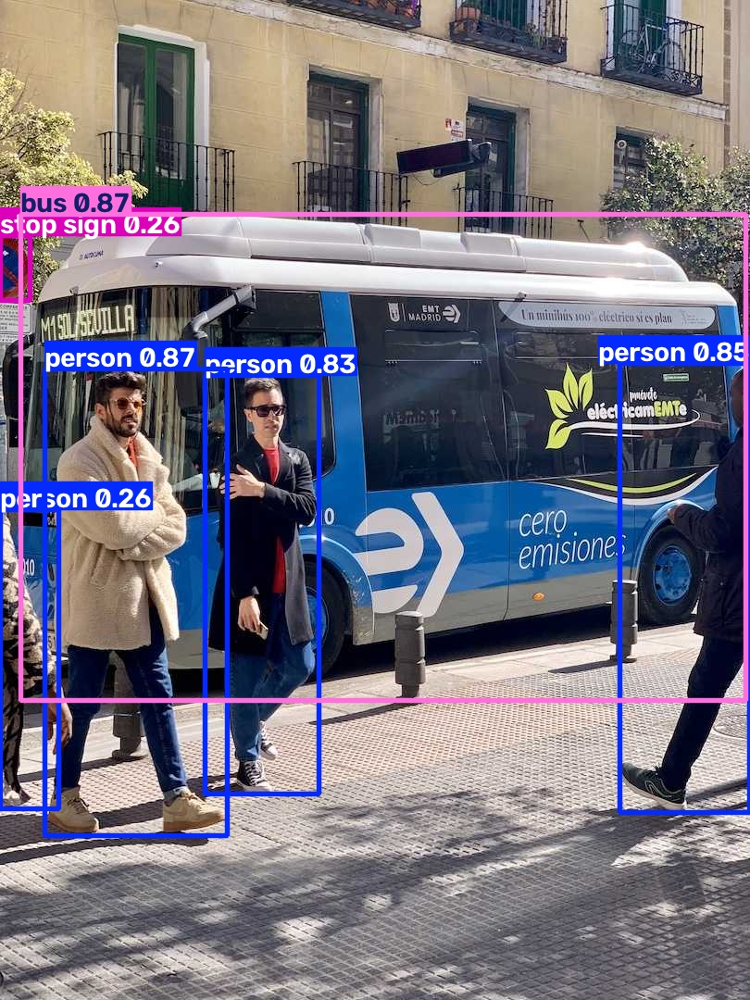

# YOLOv8 Object Detection Quickstart

A beginner-friendly project demonstrating object detection using Ultralytics YOLOv8.

## Task Objective
Load a pre-trained YOLOv8 model (`yolov8n.pt`) and use it to detect objects in an image, outputting the result with bounding boxes drawn.

---

## 🚀 Getting Started

### 1. Prerequisites
- Python 3.8 or higher installed on your system.

### 2. Set Up Virtual Environment

On Windows:
```bash
python -m venv venv
.\venv\Scripts\activate
```

On Linux / macOS:
```bash
python3 -m venv venv
source venv/bin/activate
```

### 3. Install Dependencies
```bash
pip install -r requirements.txt
```

### 4. Run Detection
```bash
python detect.py
```

The script will automatically download the pre-trained weights (`yolov8n.pt`) on its first run and save the annotated image to `results.jpg`.

---

## 📷 Results
The output image `results.jpg` contains bounding boxes and class labels (e.g., bus, person) with confidence scores detected by the YOLOv8 model:



